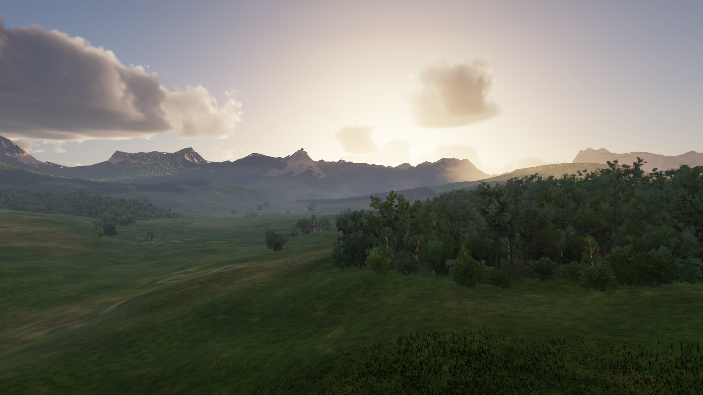
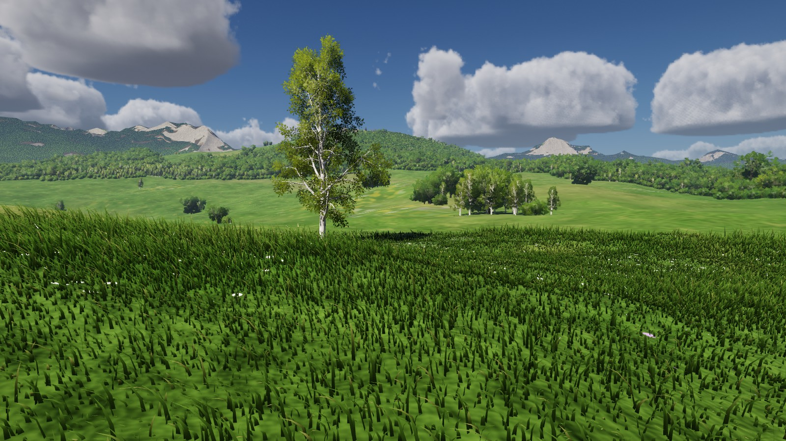
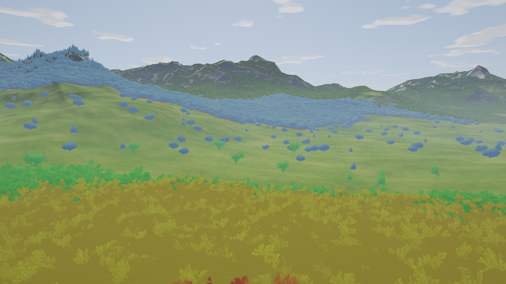

# ingenium

A small GPU-driven forest renderer in Rust + [wgpu](https://wgpu.rs): an 8 × 8 km procedural
valley with **~860,000 trees**, ferns and shrubs under them, grass, sun shadows, volumetric
clouds, sky and fog. It runs on
Vulkan/DX12 (Windows, Linux) and Metal (macOS) from the same code.



| Midday meadow | LOD debug view (`L`) |
| --- | --- |
|  |  |

Inspired by Toni Macaroni's custom-engine forest showcase. This is the same family of ideas at
hobby scale: the CPU never touches individual trees, and far-away forest is a proxy with no
per-tree data.

## Run it

```bash
cargo run --release
```

On Windows, install Rust from <https://rustup.rs> first. Its installer also offers the Visual
Studio C++ build tools it needs. Then run the command above from this folder. The first build
takes a minute or two.

| Key | Action |
| --- | --- |
| `Tab` | toggle cinematic flythrough / player |
| click / `Esc` | grab / release the mouse |
| `V` | switch the player between walking and free fly |
| walking: `W A S D`, `Space`, `Shift`, `Ctrl`/`C` | move, jump, sprint, crouch |
| flying: `W A S D`, `Space`/`E`, `Q`/`C` | move, up, down (`Shift` = fast, `Ctrl` = slow) |
| `1` `2` `3` `4` | morning · midday · golden hour · overcast |
| hold `[` / `]` | move the sun down / up through the day |
| `F` | **freeze culling**, then fly away to see exactly what the GPU decided to draw |
| `L` | colour trees by LOD (red → yellow → green = full mesh → lighter mesh → impostor) |
| `G` | toggle grass and undergrowth |
| `O` | toggle screen-space ambient occlusion |
| `H` | toggle the stats overlay |
| `-` / `=` | lower / raise the render scale |
| `F11` | borderless fullscreen |
| `P` | print the camera as a `--cam` argument |

The overlay in the top-right corner shows fps, CPU time and the median GPU time of the whole frame,
updated twice a second; it is left out of captures. The window title shows fps, CPU time, the median GPU time of the whole frame, trees drawn per LOD
and triangles per frame.

Command-line options: `--novsync` (benchmark), `--msaa 1|4`, `--scale 0.5` (render the scene at that fraction of
the output size and upscale it; a window defaults to one scene pixel per point, so half size on Retina, a capture to
full size), `--no-prepass` (shade trees without the depth prepass, to compare), `--no-grass`, `--no-occlusion` (draw the distant trees without
testing them against the near ones, to compare), `--lod 60,180` (where trees switch to the lighter mesh and to
impostors, in metres for an average-sized tree: the quality/speed trade-off), `--atmos 0-3`, `--sun-shift <degrees>`, `--size 1920x1080`,
and headless screenshots with `--capture out.png [--time 60] [--cam x,y,z,yaw,pitch] [--lod-tint] [--no-ao] [--hud] [--frames 30]`
(a negative camera height in `--cam` means that many metres above the ground). A capture renders
`--frames` frames of the same view and prints the median GPU time over the second half of them:
the whole frame, the span through the main pass, each pass (cull, grass and occluders, sky + clouds,
shadows, main, SSAO, bloom, post) and how many terrain patches each view drew.

## How it works

Every frame:

1. **Cull + LOD on the GPU** (`shaders/cull.wgsl`): one compute thread per tree (860k) does a
   frustum test, picks the full mesh (to ~60 m), the lighter mesh (to ~180 m) or the impostor
   from distance, and appends the tree's index to that bucket while incrementing the bucket's
   indirect-draw instance count. A tree is one of 12 kinds (3 species × 4 variants), each with
   a bucket per mesh LOD; the impostors of every kind share one bucket. This runs three times:
   once for the camera and once per shadow cascade.
   **Occlusion culling** (`shaders/hiz.wgsl`): the camera's pass appends only the two mesh
   LODs. They and the terrain lay down their depth first, a depth pyramid is built from it, and
   a second pass appends the impostors whose screen box isn't entirely behind it. Under the
   canopy the near trees hide almost every distant one, yet those were most of the triangles:
   about 8 ms of a 26 ms frame. Nothing comes from the last frame, so a tree is never drawn late,
   and a tree is only culled if every sample it could cover is nearer. In open country it costs
   about half a millisecond.
2. **Meadow and undergrowth** (`shaders/grass_gen.wgsl`, `shaders/undergrowth.wgsl`): compute
   shaders regenerate the meadow, and ferns, shrubs and ground cover on the forest floor, in
   world-anchored grids around the camera, so nothing swims. The meadow is ~110k grass blades
   in tufts out to 26 m (textured with scanned blades, opaque, so the GPU's hidden surface
   removal skips the ground under them), ~30k cards of scanned grass tufts out to 60 m, and
   flower and seed heads on stalks among the blades, in the same drifts the ground paints as
   dots further out. All of it is lit per vertex, so a fragment is one texture read. Under
   the trees the same grids also place **clutter**: fallen logs with broken-off stubs, fallen
   branches (both lying along the ground's slope), stumps flared into their roots, rocks and
   slabs, in the bark and rock scans. The forest-floor plants and the clutter are written in the trees'
   record layout, so the tree pipeline draws them: one indirect draw per kind.
3. **Clouds** (`shaders/clouds.wgsl`): a cloud layer 1.2–4.4 km up, wrapped around a curved
   planet, is raymarched through tiling Perlin-Worley and Worley noise volumes and a weather map
   (coverage, cloud type), all baked on the GPU at startup. Light comes from a short march towards
   the sun, a cheap multiple-scattering approximation and occluded skylight. The buffer is
   ½–¼ of the screen resolution. Each frame marches one pixel per 2×2 block and reprojects the
   other three from the previous frame, so there is at most one ray per 16 screen pixels.
   The same density also builds a 512² **cloud shadow map** over 32 km: from points on the
   cloud base, a march towards the sun gives the direct sunlight that gets through, and the
   diffuse light the cloud scatters down. The map wraps around in world space, so it survives
   camera movement and only a quarter of it (in 8×8 tiles) is refreshed per frame.
   Before the clouds, the **atmosphere** (`shaders/atmosphere.wgsl`, Hillaire 2020) rebuilds a
   192×108 sky-view table and the sun and ambient light from small transmittance and
   multiple-scattering tables. A 64×64×32 **aerial perspective** volume over the screen
   (`shaders/aerial.wgsl`) then marches each view ray through the same air plus a ground haze
   layer, in the cloud shadows, and stores the haze in front of each depth. The sky, the sun's
   colour, the ambient light, the haze on distant ridges and the light on the clouds all come
   from it, so a ridge fades into exactly the sky behind it and a preset is mostly a sun angle
   and a haze level.
4. **Shadows**: two cascades. The near one renders full leaf cards with alpha test, which
   gives the dappled light under the canopy, and the clutter. The far one renders every tree
   as its impostor, turned to face the sun and cut out by the frames baked nearest the sun's
   direction, so a tree's shadow keeps its outline at a fraction of the cost.
   Each cascade draws only the terrain patches inside its box (see below), and only the trees
   that can shade the part of the view it covers: the outline of that part as the sun sees it,
   swept towards the sun, plus a plane past its far side. The box itself is a square around a
   sphere, so most trees in it would cast their shadows off screen or behind the camera; over
   the forest this leaves out about 80% of the trees in the near cascade and 70% in the far one.
5. **Main pass** (HDR, 4× MSAA with alpha-to-coverage for leaves): CDLOD terrain, the far
   canopy shell, 25 indirect draws for all trees, grass, then the sky with the clouds
   composited over it.
   Beyond ~180 m a tree is an **impostor** (`src/impostor.rs`): at startup each variant's full
   mesh is rendered from 8 × 8 directions over the upper hemisphere (hemi-octahedral) into one
   layer of an atlas, at twice the size and reduced on the CPU: albedo and coverage, and the
   normal, ambient occlusion and whether it is leaf or bark. A tree far away is a quad facing
   the camera that blends the three frames nearest the direction it is seen from, each
   reprojected along the view ray, and is lit like the mesh with the same per-tree colour, so
   the switch is hard to spot. The mips keep each frame's alpha-tested coverage, so a distant
   crown doesn't thin out. All 12 variants bake in about 0.15 s. Where trees block the sky, the forest floor gets green **light
   through the canopy** instead (a share of the sun and sky falling on the leaves above), and
   leaves let light through from their other side, so a canopy glows seen from below.
   Leaves, fronds, conifer sprays, grass and flowers are **scanned foliage** (`src/foliage.rs`,
   CC0 plant atlases from Poly Haven in `assets/foliage/`): single scanned leaves are cut out of
   them and composed at startup into twigs of dozens of leaves, each turned, foreshortened and
   tilted, with the tilt baked into a normal map, plus roughness and translucency. Leaf cards
   pick one of several twigs (smaller-leaved, denser ones for the coarser LODs, so leaves keep
   their size across LODs) and shade each leaf with its own normal, a GGX highlight and light
   coming through in the scan's own colour. Each twig's average colour is set to what the
   painted foliage before it had, so the canopy shell still matches.
   Bark and ground are **scanned PBR materials** (`src/materials.rs`, CC0 sets from Poly Haven
   in `assets/materials/`): decoded at startup on one thread per set into two texture arrays
   with full mip chains, sRGB albedo + height and normal xy + roughness + AO. Each scan's
   average albedo is rescaled to what the surface had before, so lighting and exposure are
   unchanged, and the coarser mips fold the normals' spread into the roughness (Toksvig) so
   distant relief turns rough instead of sparkling. Trunks get a cotangent frame from screen
   derivatives (no tangents in the mesh), a GGX highlight from the roughness map and the map's
   AO; the bark wraps a whole number of times around each branch at about its real size. The
   ground blends leaf litter, moss, meadow, soil and rock by the old masks and the scans'
   heights, **hex-tiled** (each cell of a triangle grid takes the texture at a random rotation
   and offset, so nothing repeats), and fades to each scan's average once a pixel spans a good
   part of a tile.
   Ambient light everywhere is scaled by a **sky visibility** map baked
   once at startup (`shaders/sky_vis.wgsl`): from every heightmap texel, 16 directions are
   marched ~2 km out to find the horizon, with the forest counted as an 18 m canopy that blocks
   part of the sky. Valleys, the foot of slopes, clearings and the forest floor get less sky
   light and more light bounced off the surrounding ground.
6. **SSAO** (`shaders/ssao.wgsl`, half resolution, ~0.4 ms at 1080p): contact shadows where
   trunks meet the ground, between grass blades and under low branches. Lighting is forward,
   so there is no separate ambient term to darken. Instead the pass reconstructs each pixel's
   position and normal from depth, re-evaluates the sun and cloud shadow there, and occludes
   only the share of the light that was ambient. Sunlit ground next to a trunk keeps its
   sunlight.
7. **Bloom** (`shaders/bloom.wgsl`): a 6-level mip chain filtered down and added back up, so
   the sun disk (drawn at its real 0.53°) and the bright cloud edges glow.
8. **Auto exposure and tonemap** (`shaders/exposure.wgsl`, ACES): the log-average brightness
   of a 48 × 48 grid of the frame, eased over about half a second, opens the exposure by up
   to ~1.6 stops when the view is darker than open ground, the way a camera does under trees.

The CPU only writes a few uniforms and records about 100 draw calls, whatever the tree count:
76 of them are the trees' indirect draws over the depth, shadow and colour passes.

Pieces worth reading:

| File | What |
| --- | --- |
| `src/treegen.rs` | procedural trees (oak-ish, birch, spruce), forest-floor plants (fern, shrub, ground cover) and clutter (log, fallen branch, stump, rock, slab). Four skeletons per species: two forest-grown (bare trunks up to a crown that starts halfway up, crowns that are a shell of leaves around a mostly open inside, so sunflecks reach the floor), one open-grown (branching low and wide, for lone trees and forest edges) and a young tree. Two mesh LODs each: full branches + dense leaf cards (4–9k triangles), and main limbs + fewer, larger cards (0.5–2.4k). Trunks flare into buttresses where they meet the ground |
| `src/impostor.rs`, `shaders/impostor_bake.wgsl`, `shaders/tree.wgsl` (`vs_imp`) | the impostors: baking each variant into its atlas layer, the coverage-keeping mips, and the three-frame blend. `INGENIUM_IMPOSTOR_PNG=out` writes the atlases as `out_<layer>.png` |
| `src/undergrowth.rs`, `shaders/undergrowth.wgsl` | the forest-floor plants and clutter: placed around the camera each frame in drifts of fern, mats of ground cover, scattered shrubs, and logs, branches, stumps and rocks (more on rocky ground), drawn with the tree pipeline |
| `src/exposure.rs`, `shaders/exposure.wgsl` | auto exposure metering |
| `src/materials.rs`, `globals.wgsl` (`mat_hex`) | the scanned materials: loading, albedo normalisation, mips, and the hex-tiling, GGX and micro-shadow helpers the bark and ground share. The sets and their licence are listed in `assets/materials/README.md` |
| `shaders/tree.wgsl` | tree shading: scanned bark per species (birch marks painted over a pale scan), per-tree brightness and hue (blue-green to yellow-green, the odd early-turning tree) plus a shift shared by neighbouring trees; leaves with per-leaf normals from the atlas (cotangent frame from screen derivatives), GGX highlights from the scan's roughness, a sky sheen and translucency |
| `src/foliage.rs` | the scanned foliage: cutting leaves, fronds, sprays, blades and flowers out of the Poly Haven atlases (by labelling their alpha), composing twigs and branches from them, straightening grass blades into strips, colour normalisation, and mipmaps that keep each cell's alpha-test coverage so canopies don't thin out with distance. `--leaf-png out.png` writes the composed layers. Sources and licence in `assets/foliage/README.md` |
| `src/grass.rs`, `shaders/grass_gen.wgsl`, `shaders/grass.wgsl` | the meadow: blade tufts, tuft cards (which fade out when seen from above, leaving the ground to show the sward), flower and seed heads, lit per vertex |
| `src/terrain.rs`, `shaders/terrain.wgsl` | heightmap generated on the GPU; CDLOD quadtree patches that morph between levels (no cracks, no popping), picked once per frame by distance, then culled against the camera and each shadow cascade using min/max height bounds per quadtree node; the **canopy shell**: the terrain lifted by forest density and shaded as treetops, standing in for every tree beyond ~1.3 km |
| `shaders/terrain.wgsl`, `globals.wgsl` (`meadow_tint`) | the ground material: scanned leaf litter, moss, meadow, soil and rock, height-blended, under the large-scale colour of dry and lush stretches (drier on raised, open or steep ground, lusher in hollows), clumps, drifts of buttercups, daisies or clover painted as dots that fade to their average colour with distance, bare soil on slopes and worn patches, and sward relief at four scales that fades with the pixel's footprint. A grass sward isn't a flat surface, so the ground darkens when seen from above (gaps between blades), brightens at grazing angles, has a hot spot with the sun behind the viewer and glows against the sun. The grass blades take their colour from the same function, so they blend into the ground. |
| `src/clouds.rs`, `shaders/clouds.wgsl` | volumetric clouds: noise baking, the weather-driven density, lighting and the temporal reprojection; the cloud shadow map; each time-of-day preset sets the layer height, coverage and cloud types |
| `src/sky.rs`, `shaders/atmosphere.wgsl`, `shaders/aerial.wgsl` | the atmosphere tables, the sun and ambient light, and the aerial perspective volume |
| `src/forest.rs`, `shaders/scatter.wgsl` | GPU scatter of the trees (density map with gaps where an old tree fell → compact list), each given a variant from the forest around it: open-grown trees in the open and at edges, young ones at edges and in gaps, and a mantle of young trees just outside the forest that thickens its edge down to the ground; cull buffers, indirect draws |
| `src/renderer.rs` | frame orchestration, cascaded shadows, atmosphere presets, GPU timestamps |
| `src/hiz.rs`, `shaders/cull.wgsl` (`occluded`) | the depth pyramid, and the test of a tree's projected bounding sphere against it |
| `src/player.rs` | first-person controller: stands on exactly the ground that is drawn (a CPU copy of the terrain's detail noise), can't climb slopes over ~45° and slides off them, and walks around trunks. The tree list is read back from the GPU once into a one-tree-per-cell grid, the only place the CPU looks at individual trees |

## Where to take it next

- **Occlusion culling for the near trees**: they are the occluders, so they are never tested,
  and under the canopy they are now most of the frame. Testing them against last frame's depth
  pyramid first, and only the rest against this frame's, would cull the near trees hidden behind
  trunks and hills too.
- **Cluster LOD / virtual geometry**: split tree meshes into ~128-triangle clusters with a
  simplification hierarchy (see `meshoptimizer`), picked per cluster on the GPU instead of
  per tree.
- **Impostor depth**: store each frame's depth, so the three blended frames can be
  reprojected exactly where each leaf is instead of onto one plane through the tree, and the
  shadow of an impostor falls from its real shape rather than a quad.
- **Distant birches**: past ~250 m a birch's sparse crown comes out half transparent and close
  to the colour of the grass behind it, while its white trunk and limbs stay solid, so it can
  read as a dead tree. Lighter, yellower birch foliage and denser crowns at a distance would
  fix it.
- **GI**: screen-space GI plus a coarse voxel scene for off-screen bounce light.
