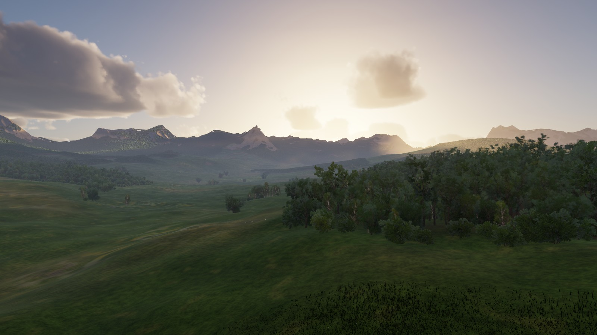
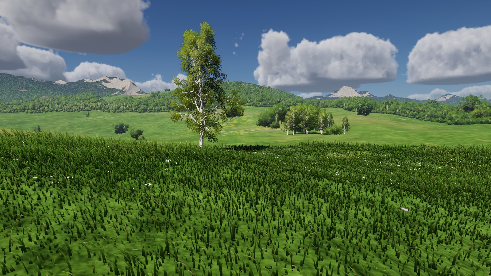
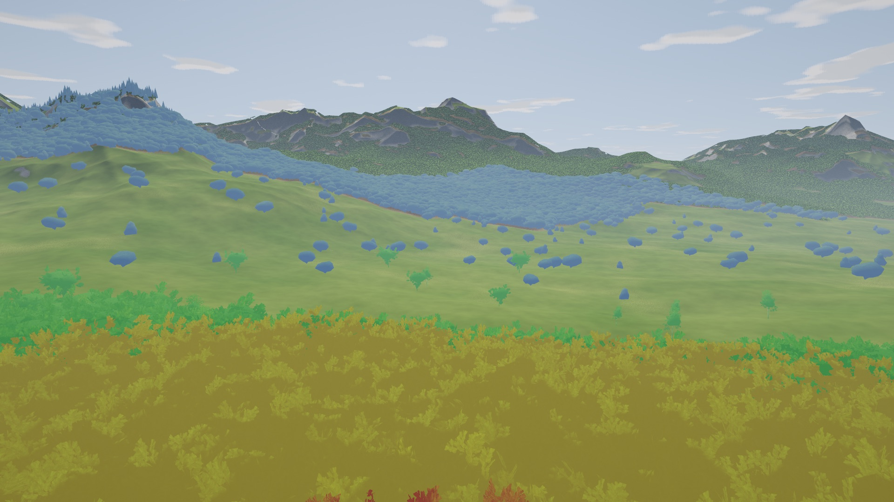

# ingenium

A small GPU-driven forest renderer in Rust + [wgpu](https://wgpu.rs): an 8 × 8 km procedural
valley with **~1.2 million trees**, grass, sun shadows, volumetric clouds, sky and fog. It runs on
Vulkan/DX12 (Windows, Linux) and Metal (macOS) from the same code.



| Midday meadow | LOD debug view (`L`) |
| --- | --- |
|  |  |

Inspired by Toni Macaroni's custom-engine forest showcase. This is the same family of ideas at
hobby scale: the CPU never touches individual trees, and far-away forest is a proxy with no
per-tree data.

## Run it

```bash
cargo run --release
```

On Windows, install Rust from <https://rustup.rs> first. Its installer also offers the Visual
Studio C++ build tools it needs. Then run the command above from this folder. The first build
takes a minute or two.

| Key | Action |
| --- | --- |
| `Tab` | toggle cinematic flythrough / player |
| click / `Esc` | grab / release the mouse |
| `V` | switch the player between walking and free fly |
| walking: `W A S D`, `Space`, `Shift`, `Ctrl`/`C` | move, jump, sprint, crouch |
| flying: `W A S D`, `Space`/`E`, `Q`/`C` | move, up, down (`Shift` = fast, `Ctrl` = slow) |
| `1` `2` `3` `4` | morning · midday · golden hour · overcast |
| hold `[` / `]` | move the sun down / up through the day |
| `F` | **freeze culling**, then fly away to see exactly what the GPU decided to draw |
| `L` | colour trees by LOD (red → yellow → green → blue = full detail → far hull) |
| `G` | toggle grass |
| `O` | toggle screen-space ambient occlusion |
| `F11` | borderless fullscreen |
| `P` | print the camera as a `--cam` argument |

The window title shows fps, CPU and GPU time, trees drawn per LOD and triangles per frame.

Command-line options: `--novsync` (benchmark), `--msaa 1|4`, `--atmos 0-3`, `--sun-shift <degrees>`, `--size 1920x1080`,
and headless screenshots with `--capture out.png [--time 60] [--cam x,y,z,yaw,pitch] [--lod-tint] [--no-ao]`
(a negative camera height in `--cam` means that many metres above the ground).

## How it works

Every frame:

1. **Cull + LOD on the GPU** (`shaders/cull.wgsl`): one compute thread per tree (1.2M) does a
   frustum test, picks one of 4 LODs from distance, and appends the tree's index to that
   (species, LOD) bucket while incrementing the bucket's indirect-draw instance count. This runs
   three times: once for the camera and once per shadow cascade.
2. **Grass** (`shaders/grass_gen.wgsl`): a compute shader regenerates ~100k blades in a
   world-anchored grid around the camera, so blades don't swim.
3. **Clouds** (`shaders/clouds.wgsl`): a cloud layer 1.2–4.4 km up, wrapped around a curved
   planet, is raymarched through tiling Perlin-Worley and Worley noise volumes and a weather map
   (coverage, cloud type), all baked on the GPU at startup. Light comes from a short march towards
   the sun, a cheap multiple-scattering approximation and occluded skylight. The buffer is
   ½–¼ of the screen resolution. Each frame marches one pixel per 2×2 block and reprojects the
   other three from the previous frame, so there is at most one ray per 16 screen pixels.
   The same density also builds a 512² **cloud shadow map** over 32 km: from points on the
   cloud base, a march towards the sun gives the direct sunlight that gets through, and the
   diffuse light the cloud scatters down. The map wraps around in world space, so it survives
   camera movement and only a quarter of it (in 8×8 tiles) is refreshed per frame.
   Before the clouds, the **atmosphere** (`shaders/atmosphere.wgsl`, Hillaire 2020) rebuilds a
   192×108 sky-view table and the sun and ambient light from small transmittance and
   multiple-scattering tables. A 64×64×32 **aerial perspective** volume over the screen
   (`shaders/aerial.wgsl`) then marches each view ray through the same air plus a ground haze
   layer, in the cloud shadows, and stores the haze in front of each depth. The sky, the sun's
   colour, the ambient light, the haze on distant ridges and the light on the clouds all come
   from it, so a ridge fades into exactly the sky behind it and a preset is mostly a sun angle
   and a haze level.
4. **Shadows**: two cascades. The near one renders full leaf cards with alpha test, which
   gives the dappled light under the canopy. The far one only renders the cheap canopy hulls.
5. **Main pass** (HDR, 4× MSAA with alpha-to-coverage for leaves): CDLOD terrain, the far
   canopy shell, 12 indirect draws for all trees, grass, then the sky with the clouds
   composited over it. Ambient light everywhere is scaled by a **sky visibility** map baked
   once at startup (`shaders/sky_vis.wgsl`): from every heightmap texel, 16 directions are
   marched ~2 km out to find the horizon, with the forest counted as a 15 m canopy that blocks
   part of the sky. Valleys, the foot of slopes, clearings and the forest floor get less sky
   light and more light bounced off the surrounding ground.
6. **SSAO** (`shaders/ssao.wgsl`, half resolution, ~0.4 ms at 1080p): contact shadows where
   trunks meet the ground, between grass blades and under low branches. Lighting is forward,
   so there is no separate ambient term to darken. Instead the pass reconstructs each pixel's
   position and normal from depth, re-evaluates the sun and cloud shadow there, and occludes
   only the share of the light that was ambient. Sunlit ground next to a trunk keeps its
   sunlight.
7. **Bloom** (`shaders/bloom.wgsl`): a 6-level mip chain filtered down and added back up, so
   the sun disk (drawn at its real 0.53°) and the bright cloud edges glow.
8. **Tonemap** (ACES) to the screen, with an exposure that partly adapts to the light level.

The CPU only writes a few uniforms and records about 40 draw calls, whatever the tree count.

Pieces worth reading:

| File | What |
| --- | --- |
| `src/treegen.rs` | procedural trees (oak-ish, birch, spruce). One branch skeleton per species, 4 LODs: full branches + ~1000 leaf cards → fewer cards → huge cards + hull → a 80-triangle "union of spheres" canopy hull |
| `shaders/tree.wgsl` | tree shading: per-tree brightness and hue (blue-green to yellow-green, the odd early-turning tree) plus a shift shared by neighbouring trees, translucency, and a soft waxy highlight and sky sheen on the leaves |
| `src/leaftex.rs` | foliage textures painted in code; mipmaps keep alpha-test coverage so canopies don't thin out with distance |
| `src/terrain.rs`, `shaders/terrain.wgsl` | heightmap generated on the GPU; CDLOD quadtree patches that morph between levels (no cracks, no popping); the **canopy shell**: the terrain lifted by forest density and shaded as treetops, standing in for every tree beyond ~1.3 km |
| `shaders/terrain.wgsl`, `globals.wgsl` (`meadow_tint`) | the ground material: dry and lush stretches (drier on raised, open or steep ground, lusher in hollows), clumps, drifts of buttercups, daisies or clover painted as dots that fade to their average colour with distance, bare soil on slopes and worn patches, and sward relief at four scales that fades with the pixel's footprint. A grass sward isn't a flat surface, so the ground darkens when seen from above (gaps between blades), brightens at grazing angles, has a hot spot with the sun behind the viewer and glows against the sun. The grass blades take their colour from the same function, so they blend into the ground. |
| `src/clouds.rs`, `shaders/clouds.wgsl` | volumetric clouds: noise baking, the weather-driven density, lighting and the temporal reprojection; the cloud shadow map; each time-of-day preset sets the layer height, coverage and cloud types |
| `src/sky.rs`, `shaders/atmosphere.wgsl`, `shaders/aerial.wgsl` | the atmosphere tables, the sun and ambient light, and the aerial perspective volume |
| `src/forest.rs` | GPU scatter of the trees (density map → compact list), cull buffers, indirect draws |
| `src/renderer.rs` | frame orchestration, cascaded shadows, atmosphere presets, GPU timestamps |
| `src/player.rs` | first-person controller: stands on exactly the ground that is drawn (a CPU copy of the terrain's detail noise), can't climb slopes over ~45° and slides off them, and walks around trunks. The tree list is read back from the GPU once into a one-tree-per-cell grid, the only place the CPU looks at individual trees |

## Where to take it next

- **Hi-Z occlusion culling**: build a depth pyramid and skip trees hidden behind hills and
  other trees. In a dense forest that removes most of the work.
- **Cluster LOD / virtual geometry**: split tree meshes into ~128-triangle clusters with a
  simplification hierarchy (see `meshoptimizer`), picked per cluster on the GPU instead of
  per tree.
- **Voxel far field**: voxelise each species into a small 3D texture and raymarch it for
  distant trees instead of drawing hulls.
- **GI**: screen-space GI plus a coarse voxel scene for off-screen bounce light.
